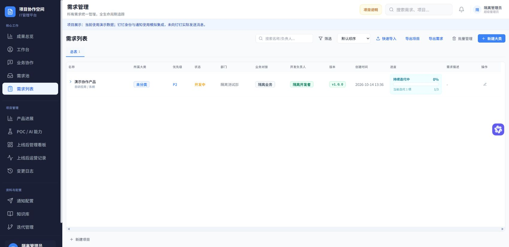

# IT Project Workspace · IT 项目协作空间

面向 IT 团队的项目协作与交付管理应用，覆盖需求提报、评审、实施、交付验证、上线运营和价值回访。

**[在线演示](http://114.55.146.5/pm-v2/preview-login)** · **[工程架构](docs/ARCHITECTURE.md)** · **[模块说明](docs/MODULES.md)** · **[开发与接手](docs/DEVELOPMENT.md)**

在线地址无需账号密码，默认演示管理员。使用合成数据与模拟钉钉集成，未实际发送消息；真实供应方适配器已实现并做协议模拟测试，尚未进行真实应用联调。本仓库提供系统源码与独立开发工具，在线部署保留现有数据和访问地址。

## 功能

- L1 分类、L2 项目、L3 工作及阶段管理、共享动态、评论和附件。
- 需求池、评审/补充、分支决策、业务确认与正式工作转换。
- 交付标准、业务验证、显式 IT 交付、3 天与30天回访。
- 上线运营、问题、改善提案、知识记录及管理统计。
- PoC/AI 能力沉淀、个人绩效与定稿、通知规则、个人待办和工作同步。
- 人员配置、内置/自定义角色、页面/动作/资源权限和回收站。



## 工程结构

Vue 3 / TypeScript / Vite / Tailwind；Python 3.12 / FastAPI / Pydantic / SQLAlchemy Core；PostgreSQL 18；Nginx / systemd。

```text
backend/itpm/      模块化单体、规则、事务、公开能力、跨模块工作流
frontend/         页面、业务状态、类型化客户端与统一传输
contracts/        OpenAPI、数据库目录/映射、初始化结构与UI基线
tests/            独立规则/API/PostgreSQL/完整链路回归
scripts/          安装、初始化、启动、契约生成、验证、打包
deploy/           Nginx/systemd样例与发布/备份/恢复工具
docs/             业务、架构、模块、接口、事件、数据和维护说明
```

业务事务与通知分离；数据库启动仅检查结构和运行账号，不自动建表、填数据或启动调度线程。外部集成由适配器提供，业务模块不直接调用钉钉 SDK。

## 本地运行

需要 Python 3.12、Node.js 22 或24、专用 PostgreSQL 18（127.0.0.1:55432）。依赖版本由锁文件确定。

Windows PowerShell：

```powershell
git clone https://github.com/coldwind-fss/it-project-workspace.git
cd it-project-workspace
python scripts/setup.py
Copy-Item .env.example .env
# 编辑 .env，填写专用本地 PostgreSQL 的初始化连接。
.\.venv\Scripts\python.exe scripts/runtime.py
.\.venv\Scripts\python.exe scripts/seed_demo.py
.\scripts\dev.ps1
```

打开 **http://127.0.0.1:3004/pm/**，首次进入自动建立演示会话。按 Ctrl+C 停止本次开发进程。Linux/macOS、PostgreSQL准备、前端构建和故障排查见 [开发指南](docs/DEVELOPMENT.md)。

验证：

```powershell
.\scripts\verify.ps1
```

CI执行同一套独立关卡，不需要旧仓库、聊天记录或作者的本机路径。结果留在忽略的 `.runtime/test-results/`；验证范围及限制见 [维护说明](docs/MAINTENANCE.md)。

## 后续开发

从 [业务基线](docs/PRODUCT_BASELINE.md) 开始，再阅读 [接口规范](docs/API_CONVENTIONS.md)、[事件规范](docs/EVENTS.md) 和 [CONTRIBUTING](CONTRIBUTING.md)。新增能力先明确契约与验收，再进入责任模块；人和AI均遵守仓库的 [AGENTS.md](AGENTS.md)。

当前仓库从已完成的重构成果提取，保留业务能力，并整理为独立运行与维护的公开版本。开发过程包含AI辅助实现与验证。本仓库不包含公司历史数据或部署凭据。

已知开发/构建依赖告警与本次兼容修复见 [SECURITY](SECURITY.md)；功能验证通过不代表全部依赖安全审计通过。

尚未选择开源许可证；公开可查看不等同于授予任意复用许可。
