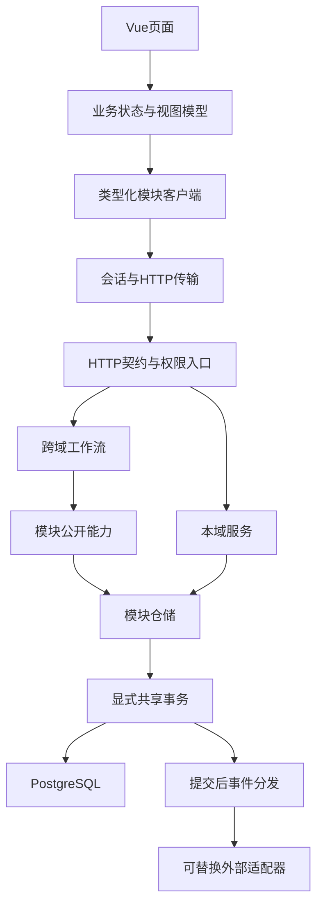

# 工程架构

采用模块化单体：业务关系密集，必要跨域结果可以在一个PostgreSQL事务内完成。入口由 `backend/itpm/app.py` 组合依赖，独立worker由 `scripts/serve.py --worker` 运行。

## 职责与依赖

- router：解析输入、响应映射与调用用例，不写SQL。
- service：本域用例；rules：不访问环境/SQL/HTTP的纯规则。
- repository：显式列映射、参数化SQL，不自行commit/rollback。
- public：提供跨模块能力；workflow：编排跨域写入，共用UoW，避免业务服务相互调用形成环。
- infrastructure：连接、文件存储、HTTP边界和外部供应方；core：Principal、Clock、ID、错误、事件与基础接口。
- 前端pages保留呈现，features管理状态，API客户端描述协议，transport负责会话和错误。页面不复制后端权威资格/统计规则。

模块不得导入旧系统、app、router或workflows，不能访问peer私有仓储；供应方实现由组合根注入。`scripts/architecture.py`检查导入图/环、规则纯度、事务归属和前端越层；`contracts/ui-baseline.json`保存当前被接受的模板/样式回归基线。

## 事务、身份和外部作用

业务及必需审计先提交；事务失败丢弃事件。通知消费者在提交后运行；必要的原同步发送结果在HTTP响应前形成。发送失败不回滚已提交业务。文件暂存/关联采用现有一致性处理，不声称文件系统与PG是一个原子事务。

Principal来自有效服务器会话；页面/动作/资源范围在identity及用例中执行。演示会话只在preview配置注册，白名单身份按本地配置授予权限；真实生产配置不提供公开演示登录。

数据库启动只检查51表目录及运行角色，不DDL、不seed、不启动worker。连接账号无建库/建角色/CREATE/TEMP能力。显式初始化仅用于受保护的空合成库。库结构演进必须另做迁移计划。

外部适配器支持Fake/Disabled/Real。真实凭据外置；构造/import不访问外部网络；供应方HTTP调用不持有业务连接。既有持久任务支持已证明的恢复/去重，普通事件没有通用outbox/exactly-once保证。

## 可执行入口

- [模块与所有权](MODULES.md)
- [API契约](API_CONVENTIONS.md) / [事件](EVENTS.md) / [数据](DATA_MODEL.md)
- `python scripts/contracts.py --check`：结构契约漂移。
- `python scripts/verify.py`：独立类型/构建/架构/仓库/协议/PG回归。
- [部署与恢复](DEPLOYMENT.md)：源码提交、包哈希、运行配置和数据分别管理。
