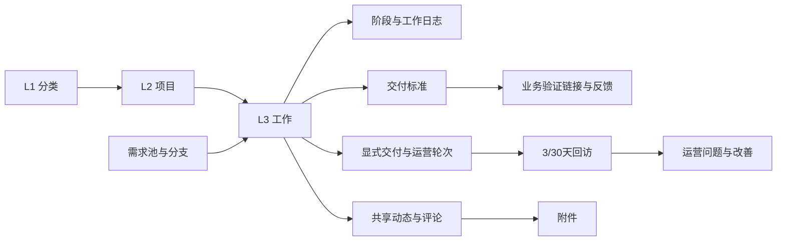

# 数据结构与所有权

PostgreSQL采用既有51表结构。完整字段、默认、空值、索引、约束和函数以 [schema-manifest.json](../contracts/schema-manifest.json) 为目录，显式API/物理列映射在 [column-aliases.json](../contracts/column-aliases.json)。[schema.sql](../contracts/schema.sql)只用于受保护的空合成库初始化。

这是业务关系图，不宣称每条关系都有物理FK。关联ID、JSON TEXT快照、历史别名/状态及软删含义保留；不能为了统一命名重写历史ID或把空串/null/0混成同一种值。

每表写入归属见 [MODULES](MODULES.md)。insights等只读投影可以跨表SELECT，但不能“修正”源事实。业务审计和必需关联共享事务，文件操作经独立一致性流程。

## 初始化和运行

`scripts/runtime.py`只接受本地55432和pm_test_rebuild_前缀库，显式创建受限账号、空库结构。`scripts/seed_demo.py`显式生成合成人员/一个完整业务样例，不覆盖已有项目；应用启动不会执行DDL或seed。

运行账号不能建库、建角色、创建public对象或TEMP表。readiness在目录/权限不一致时失败，不偷偷补列。测试使用独立UUID库，不读作者已有项目库。

## 真正需要迁移时

先明确字段/业务含义、调用方与历史采用方式，设计迁移脚本和版本记录位置，备份并在独立恢复库演练。验证记录/关联/快照/附件与继续操作，再发布。破坏性schema变化必须定义数据恢复，不把换代码指针当数据库回滚；当前项目不伪称已有完整自动迁移体系。
